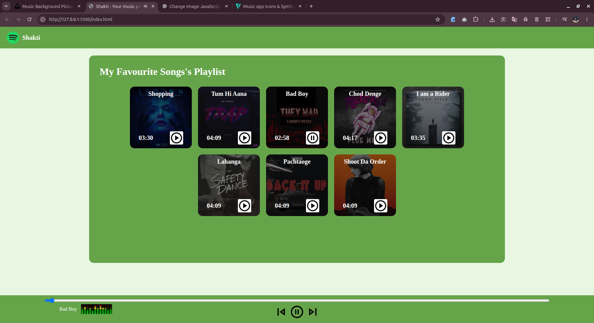

# Shakti

Shakti is a lightweight, browser-based music player built with vanilla HTML, CSS, and JavaScript. It provides a local playlist interface with individual track controls, master playback controls, progress tracking, seeking, and previous/next navigation.

The project is fully static: it does not require a backend, database, package manager, or external API.

## Table of Contents

- [Overview](#overview)
- [Screenshots and Demo](#screenshots-and-demo)
- [Features](#features)
- [Tech Stack](#tech-stack)
- [Prerequisites](#prerequisites)
- [Installation and Setup](#installation-and-setup)
- [Usage](#usage)
- [Current Playlist](#current-playlist)
- [Project Structure](#project-structure)
- [Configuration and Environment Variables](#configuration-and-environment-variables)
- [Troubleshooting](#troubleshooting)
- [Contributing](#contributing)
- [License](#license)
- [Project Links](#project-links)

## Overview

Shakti presents a playlist of locally bundled audio tracks in a card-based interface. Track names and cover artwork are populated from the `songs` array in `script.js`, while the audio files and visual assets are loaded from the repository.

The player uses the browser's native HTML5 audio functionality to:

- Play and pause audio.
- Select tracks directly from the playlist.
- Navigate to the next or previous track.
- Display and update playback progress.
- Seek through a track using the progress bar.
- Calculate and display track duration from audio metadata.
- Show the currently selected song and a playback animation.

## Screenshots and Demo

Try the deployed version:

**[Open the live demo](https://musicplayer-seven-tau.vercel.app/)**



## Features

- Eight playlist cards rendered in the interface.
- Individual play and pause controls for each track.
- Master play/pause control.
- Previous and next track controls.
- Circular previous/next navigation when the beginning or end of the playlist is reached.
- Real-time progress bar updates during playback.
- Seek support through the progress bar.
- Track duration detection using audio metadata.
- Cover artwork displayed as each playlist card's background.
- Playback animation displayed while a track is playing.
- Local audio and image assets with no backend dependency.
- Static deployment support, including the current Vercel demo.

## Tech Stack

| Area | Technology |
| --- | --- |
| Markup | HTML5 |
| Styling | CSS3 |
| Application logic | Vanilla JavaScript |
| Audio playback | Browser HTML5 `Audio` API |
| Audio format | Local MP3 files |
| Image assets | JPEG, PNG, and GIF files |
| Deployment | Static hosting; the current demo is deployed on Vercel |

No JavaScript framework, CSS framework, build tool, or third-party runtime dependency is used.

## Prerequisites

To run the project locally, you need:

- A modern web browser with JavaScript and MP3 playback support.
- Python 3, only if you want to use the included local static-server command.

There is no `package.json`, dependency lockfile, or build configuration. No `npm install` step is required.

## Installation and Setup

### 1. Clone the repository

```bash
git clone https://github.com/pari0192/Song-Player.git
cd Song-Player
```

### 2. Start a local web server

Run the server from the project root, the directory containing `index.html`:

```bash
python3 -m http.server 8000
```

### 3. Open the application

Visit the following address in your browser:

```text
http://localhost:8000/index.html
```

To stop the local server, press `Ctrl+C` in the terminal where it is running.

Serving the project through a local HTTP server is recommended because all audio, image, stylesheet, and JavaScript paths are relative to the project files.

## Usage

1. Open the application in your browser.
2. Select the play icon on any playlist card to start that track.
3. Use the bottom play/pause control to control the currently loaded audio.
4. Use the previous and next buttons to move through the playlist.
5. Drag or click the progress bar to seek through the current track.
6. When playback is active, the animated visualizer appears beside the current song information.
7. Use the individual track control again to pause the currently playing track.

The player calculates visible track durations after the browser loads each audio file's metadata.

## Current Playlist

The active playlist is defined in the `songs` array in `script.js`.

| Playlist position | Track name | Audio file | Cover file |
| ---: | --- | --- | --- |
| 1 | Shopping | `songs/1.mp3` | `covers/1.jpg` |
| 2 | Tum Hi Aana | `songs/2.mp3` | `covers/2.jpg` |
| 3 | Bad Boy | `songs/3.mp3` | `covers/3.jpg` |
| 4 | Chod Denge | `songs/4.mp3` | `covers/4.jpg` |
| 5 | I am a Rider | `songs/5.mp3` | `covers/5.jpg` |
| 6 | Lahanga | `songs/2.mp3` | `covers/6.jpg` |
| 7 | Pachtaoge | `songs/2.mp3` | `covers/7.jpg` |
| 8 | Shoot Da Order | `songs/2.mp3` | `covers/8.jpg` |

The repository also contains `songs/6.mp3`, `songs/7.mp3`, `songs/8.mp3`, and `covers/9.jpg` and `covers/10.jpg`. These files are present as assets but are not currently referenced by the active playlist configuration in `script.js`.

## Project Structure

```text
Song-Player/
├── index.html          # Main page structure and player controls
├── style.css           # Layout, colors, card styling, and fixed player controls
├── script.js           # Playlist data and playback behavior
├── README.md           # Project documentation
│
├── logo.png            # Branding image displayed in the navigation bar
├── play.png            # Play icon
├── pause.png           # Pause icon
├── backward.png        # Previous-track icon
├── forward.png         # Next-track icon
├── playing.gif         # Playback animation shown while audio is playing
├── bg.jpg              # Bundled background image
├── bg2.jpg             # Bundled background image
│
├── covers/
│   ├── 1.jpg
│   ├── 2.jpg
│   ├── 3.jpg
│   ├── 4.jpg
│   ├── 5.jpg
│   ├── 6.jpg
│   ├── 7.jpg
│   ├── 8.jpg
│   ├── 9.jpg
│   └── 10.jpg
│
└── songs/
    ├── 1.mp3
    ├── 2.mp3
    ├── 3.mp3
    ├── 4.mp3
    ├── 5.mp3
    ├── 6.mp3
    ├── 7.mp3
    └── 8.mp3
```


## Configuration and Environment Variables

### Environment variables

This project does not use environment variables or a `.env` file.

### Playlist configuration

Playlist data is stored directly in `script.js`:

```javascript
let songs = [
    {
        songName: "Shopping",
        filePath: "songs/1.mp3",
        coverPath: "covers/1.jpg",
        timestamp: "03:45"
    }
];
```

To change a track:

1. Add or replace the required MP3 file inside `songs/`.
2. Add or replace the corresponding cover image inside `covers/`.
3. Update the matching object in the `songs` array.
4. Keep the playlist order aligned with the eight `.songItem` elements in `index.html`.
5. Preserve the relative file paths used by the JavaScript configuration.

The playlist buttons in `index.html` use IDs from `0` through `7`. These IDs correspond to the zero-based positions in the `songs` array.

The visible duration is calculated from each audio file's metadata when it loads. The current script does not read the `timestamp` property when calculating the displayed duration.

## Troubleshooting

### The page loads but audio does not play

- Confirm that you started the server from the project root.
- Check that the referenced MP3 file exists under `songs/`.
- Click a play control manually. Browsers commonly restrict audio playback that is not initiated by a user interaction.
- Confirm that your browser supports MP3 playback.

### Images or controls are missing

- Check that filenames match the paths in the source code exactly.
- Linux and other Unix-like systems use case-sensitive paths.
- Confirm that image files remain in the repository root or the `covers/` directory as expected.

### The playlist does not update after editing

- Confirm that the edited object is inside the `songs` array in `script.js`.
- Ensure the number and order of playlist cards in `index.html` still match the configured song entries.
- Refresh the browser after saving changes.

## Contributing

Contributions are welcome. Because this is a small static project, changes should remain focused and preserve the existing file-based structure.

1. Fork the repository.
2. Create a feature or fix branch:

   ```bash
   git switch -c feat/your-change
   ```

3. Make the required changes.
4. Run the project locally:

   ```bash
   python3 -m http.server 8000
   ```

5. Manually verify:

   - Individual track playback.
   - Master play/pause behavior.
   - Previous and next navigation.
   - Progress bar updates and seeking.
   - Track names, cover images, and durations.
   - Playback behavior after changing or adding assets.

6. Commit the change with a clear message.
7. Open a pull request describing what changed and why.

The repository does not currently include an automated test suite or lint configuration, so browser-based manual verification is the available validation method.

## License

This repository does not currently include a `LICENSE` file or declare a software license.

Until a license is added, do not assume that the source code, audio files, images, or other bundled media may be reused, modified, or redistributed. If the project is intended to be shared under a specific license, add a root-level `LICENSE` file and update this section accordingly.

## Project Links
- **Live demo:** [musicplayer-seven-tau.vercel.app](https://musicplayer-seven-tau.vercel.app/)